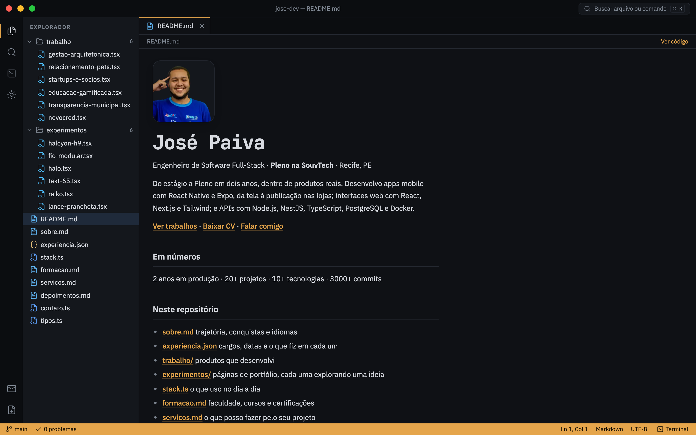
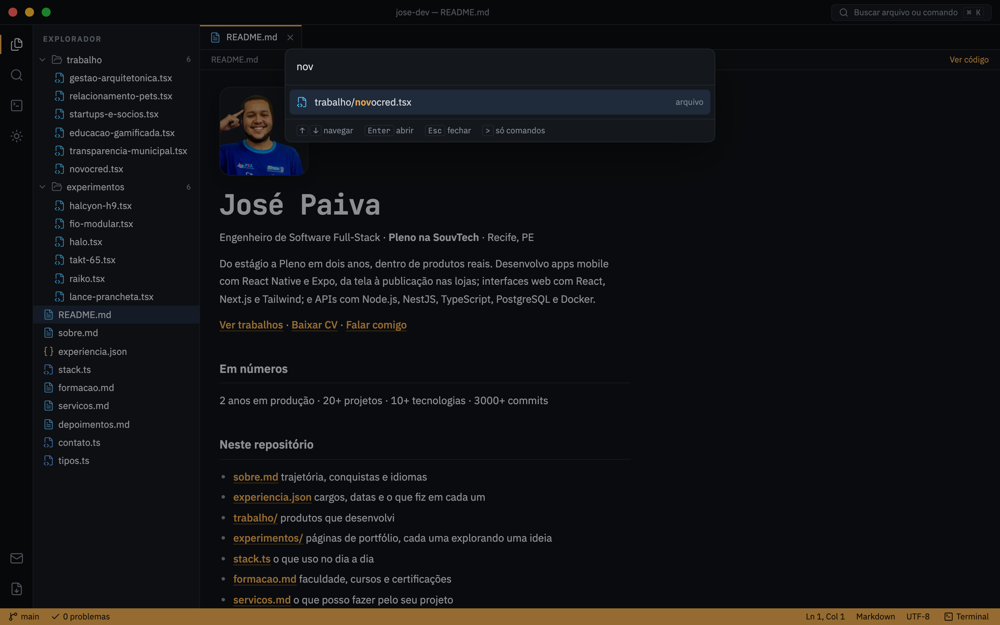
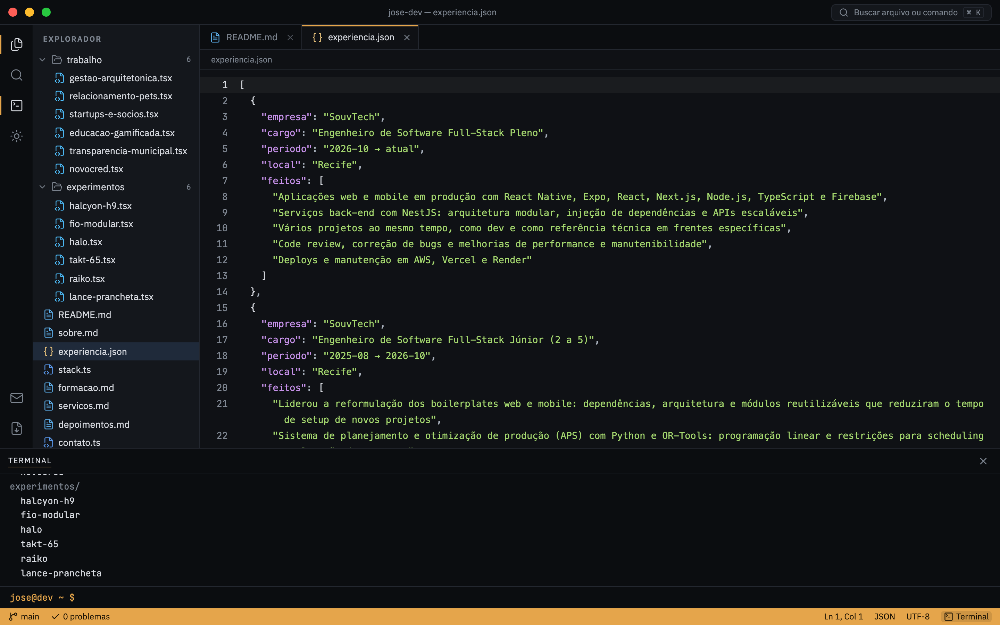
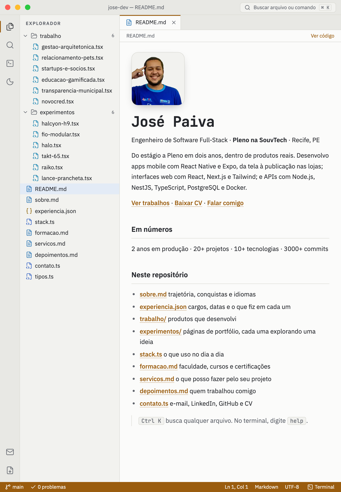
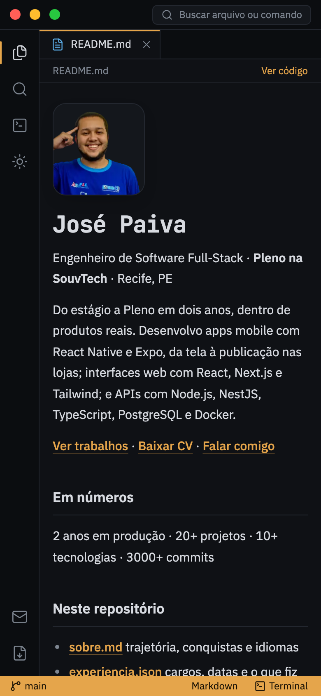
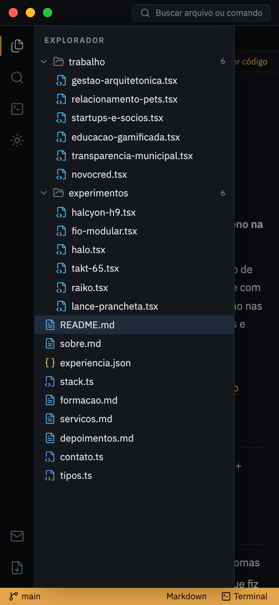
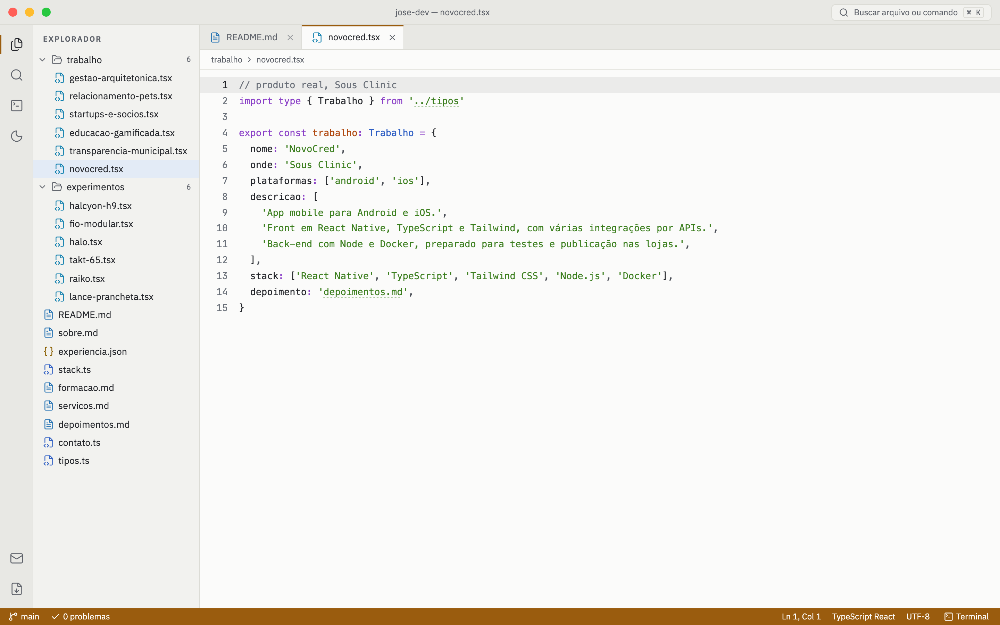

# jose-dev

Portfólio de **José Paiva**, Engenheiro de Software Full-Stack (Pleno na SouvTech, Recife). O portfólio é um editor de código que funciona: a carreira, os trabalhos e o contato são arquivos que você abre, busca pela paleta de comandos ou consulta pelo terminal.







<p align="center">
  
  &nbsp;
  
  &nbsp;
  
</p>



## O que dá pra fazer

- **Abrir arquivos** pelo explorador: `README.md` (boas-vindas), `sobre.md`, `experiencia.json`, `stack.ts`, `formacao.md`, `servicos.md`, `depoimentos.md`, `contato.ts`, e as pastas `trabalho/` (produtos reais) e `experimentos/` (páginas de portfólio)
- **Paleta de comandos** com `Ctrl K` ou `⌘ K`: busca aproximada em arquivos; com `>`, só comandos (tema, terminal, baixar CV, copiar e-mail, LinkedIn, GitHub)
- **Terminal** com `` Ctrl ` ``: `help`, `ls`, `cat`, `open`, `projetos`, `whoami`, `contato`, `email`, `cv`, `linkedin`, `github`, `theme`, `clear`, com histórico (↑ ↓) e autocompletar (Tab)
- **Abas** que abrem e fecham (botão do meio também fecha), pré-visualização ou código no Markdown, links clicáveis dentro do código (e-mail, perfis, CV e imports)
- **Link direto para um arquivo**: o arquivo aberto fica no endereço, por exemplo `/#/trabalho/novocred.tsx`
- **Tema claro e escuro**, seguindo o sistema na primeira visita e lembrado depois
- **Botões da janela**: fechar todas as abas, mostrar ou ocultar o explorador e tela cheia

Funciona com mouse, teclado e toque. No celular, o explorador vira uma gaveta e o terminal ocupa parte da tela. Respeita a preferência do sistema por menos movimento.

## Tecnologias

| Tecnologia                                                                   | Uso                                                         |
| ---------------------------------------------------------------------------- | ----------------------------------------------------------- |
| [Next.js 16](https://nextjs.org) (App Router)                                | framework, renderização no servidor, fontes e imagem        |
| [React 19](https://react.dev) + [TypeScript](https://www.typescriptlang.org) | interface e tipagem                                         |
| [Shiki](https://shiki.style)                                                 | destaque de sintaxe do VS Code, gerado no build             |
| [Motion](https://motion.dev)                                                 | abas, paleta, terminal, gaveta e a entrada da primeira tela |
| [Tailwind CSS 4](https://tailwindcss.com)                                    | estilos, temas por variáveis e layout responsivo            |
| [Lucide](https://lucide.dev)                                                 | ícones                                                      |
| [Playwright](https://playwright.dev)                                         | geração dos prints deste README                             |
| ESLint + Prettier                                                            | padrão de código e formatação                               |

## Como rodar

Precisa de [Node.js](https://nodejs.org) 22 ou mais recente.

```bash
npm install
npm run dev
```

Abra http://localhost:3000. Para testar no celular na mesma rede Wi-Fi, rode `npm run dev -- -H 0.0.0.0` e acesse `http://<ip-do-seu-computador>:3000`.

### Comandos

| Comando               | O que faz                                                                                       |
| --------------------- | ----------------------------------------------------------------------------------------------- |
| `npm run dev`         | servidor de desenvolvimento                                                                     |
| `npm run build`       | verifica os tipos e gera a versão de produção                                                   |
| `npm run start`       | serve a versão de produção (depois do build)                                                    |
| `npm run lint`        | ESLint                                                                                          |
| `npm run format`      | Prettier em todo o projeto                                                                      |
| `npm run check`       | testa o domínio: abas, arquivos, busca aproximada e comandos do terminal                        |
| `npm run screenshots` | gera os prints em `docs/` (depois do build; na primeira vez, `npx playwright install chromium`) |

## Atualizar o conteúdo

Todos os fatos (cargos, datas, projetos, stack, contato, depoimento) ficam em **`src/domain/profile.ts`**. Os arquivos do editor são gerados a partir dele em `src/domain/files.ts`, então basta editar o perfil.

## Estrutura

```
src/
├── app/                   layout (fontes, tema sem piscar), página e estilos globais
├── domain/
│   ├── profile.ts         fonte única dos fatos do portfólio
│   ├── files.ts           arquivos virtuais do editor, gerados a partir do perfil
│   ├── editor.ts          abas, pastas e modo código ou pré-visualização (reducer)
│   ├── fuzzy.ts           busca aproximada da paleta
│   └── terminal.ts        comandos do terminal e autocompletar
├── lib/                   destaque de sintaxe (Shiki, no servidor) e utilitário cn
├── providers/             estado do editor, tema, painéis e Motion
├── hooks/                 atalhos de teclado
├── components/
│   ├── atoms/             FileIcon, Kbd, ActivityButton
│   ├── molecules/         ExplorerTree, TabBar, CodeView, MarkdownView
│   └── organisms/         TitleBar, ActivityBar, Explorer, EditorArea, Terminal, StatusBar, CommandPalette, Workbench
└── constants/             curvas de animação
```

Imports usam aliases: `@atoms/*`, `@molecules/*`, `@organisms/*`, `@domain/*`, `@providers/*`, `@hooks/*`, `@lib/*`, `@constants/*`.

O contexto de produto e as decisões de design ficam em `PRODUCT.md`, `DESIGN.md` e `.impeccable/direction.md`.
